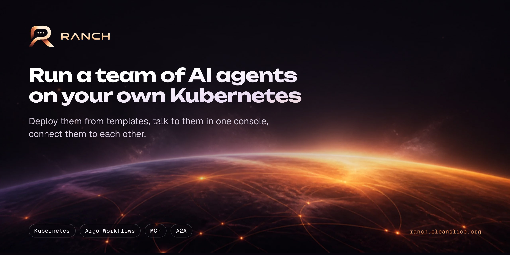
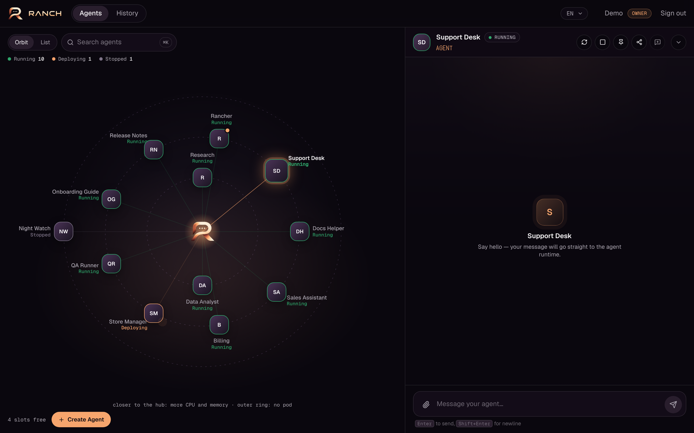
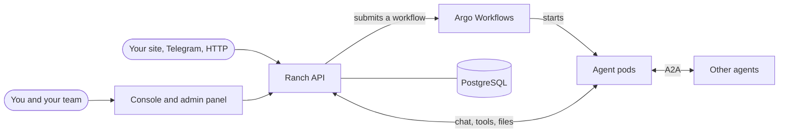

# Ranch

Ranch runs AI agents as pods on Kubernetes. You describe an agent once as a template, start as many as you need, and talk to them from one console. Each agent keeps its own tools, files, secrets and knowledge.

[Live demo](https://ranch.cleanslice.org) · [Quick start](#quick-start) · [Examples](#examples) · [Guides](docs/guides)



## What you get

- **Agents as pods.** Start, stop and restart them, set CPU and memory per agent, watch their status live.
- **A console for people.** Chat with any agent, follow its steps and sources, share a chat by link.
- **An admin panel for operators.** LLM keys, skills, MCP servers, knowledge bases, evaluations, usage and cost per agent.
- **Agents that ask each other.** Connect a peer over A2A and an agent can hand it a question it cannot answer itself.
- **Ways in from outside.** A script tag for your site, a Telegram bot, an HTTP endpoint.

## Quick start

You need [Bun](https://bun.sh) and [Docker](https://docs.docker.com/get-docker/).

```bash
bun add -g @cleanslice/ranch   # or: npm install -g @cleanslice/ranch
ranch dev
```

The first run offers to clone this repository. Then it starts the API, both web apps, PostgreSQL and a local k3d cluster, so agents run as real pods on your machine. The first start is slow, because it pulls every image, the knowledge stack included: Ollama, LightRAG and its own PostgreSQL.

The two Ollama models that stack uses are fetched on first use rather than at startup; `make lightrag-up` pulls them up front instead, about 3 GB. To leave the cluster and the knowledge stack out, run `ranch dev --no-k3d`, or name a single app: `ranch dev admin`.

| Open | To |
|---|---|
| http://localhost:3002 | set things up in the admin panel |
| http://localhost:3001 | talk to agents in the console |
| http://localhost:3000/api | browse the API (Swagger) |

Your first agent takes four steps in the admin panel:

1. Create the owner account. The panel asks for it on first open.
2. Add a model key under **LLMs**.
3. Add a template under **Templates**: write one, or install it from a zip or a git repository.
4. Press **New agent**, pick the template and the key. The agent starts as a pod, and its chat opens when it is running.

`ranch down` stops everything. All commands: [`cli/README.md`](cli/README.md).

## Examples

The examples use two variables:

```bash
export RANCH_API=http://localhost:3000
export AGENT_ID=<the agent's id, from its page address in the admin panel>
```

### Ask an agent over HTTP

Create an API key with the `embed:mint` scope under **API Keys**, then mint a short-lived token for the person who is asking:

```bash
curl -X POST "$RANCH_API/auth/embed/token" \
  -H "Authorization: Bearer $RANCH_API_KEY" \
  -H "Content-Type: application/json" \
  -d '{"sub":"user-123","email":"alice@example.com","expiresIn":"1h"}'
```

```json
{ "token": "eyJhbGciOiJIUzI1NiIs…", "expiresAt": "2026-11-16T18:45:00.000Z" }
```

Put the `token` in `$TOKEN`, send a message and wait for the reply:

```bash
curl -X POST "$RANCH_API/api/agent/$AGENT_ID/message/sync" \
  -H "Authorization: Bearer $TOKEN" \
  -H "Content-Type: application/json" \
  -d '{"text":"What is your refund policy?"}'
```

```json
{ "text": "<the agent's answer>", "messageId": "a1b2c3…", "ts": 1763318700123 }
```

`ts` is the hub clock in milliseconds. Each `sub` gets its own conversation and history. Without `expiresIn` a token lives 15 minutes.

The route waits up to 120 seconds for the agent. A timeout is still `200`, with the sentence `Timeout: no response from agent` in `text` — check the text, not the status. Owner and Admin roles are stripped from a minted token unless the key also carries `embed:mint-admin`, and such a token is capped at 7 days.

### Put the chat on your site

```html
<script
  src="https://bridle.cleanslice.org/sdk/latest.js"
  data-api-url="https://api.your-ranch.example"
  data-agent-id="AGENT_ID"
  data-token="JWT_FROM_YOUR_BACKEND"
></script>
```

This adds a chat bubble to the page. For a public agent, list your site under **Allowed origins** and drop `data-token`. The admin panel shows the snippet for every agent, including an inline variant that mounts into your own container.

### Share one chat by link

Press **Share** on an agent in the console. You get one public link that opens a chat with that agent and nothing else: no login, no other pages. Regenerate the link to cut off the old one, or revoke it.

### Let one agent ask another

Open an agent in the admin panel, go to **A2A** and connect a peer: another agent of this ranch, or an external A2A agent by its address. After a restart the agent has a delegation tool, and it tries a suitable peer before answering "I don't know". The chat shows which peer was asked and why.

### Hear about a failed agent in Slack

Ranch watches the agents it starts. Your cluster tooling can report a failure too, with an API key that has only the `events:write` scope:

```bash
curl -X POST "$RANCH_API/agent-events" \
  -H "Authorization: Bearer $RANCH_API_KEY" \
  -H "Content-Type: application/json" \
  -d '{"agentId":"'"$AGENT_ID"'","status":"failed","reason":"CrashLoopBackOff"}'
```

Choose where the team is told under **Settings → Notifications**. Details: [`docs/operations/agent-events.md`](docs/operations/agent-events.md). What *Limited tools* means on that page: [`docs/operations/agent-tools-state.md`](docs/operations/agent-tools-state.md).

## How it works



The API is the only thing people and other systems talk to. It keeps agents, templates and chats in PostgreSQL, asks Argo Workflows to start a pod for each agent, and relays chat between the pod and whoever is asking. Agent files, skills and secrets live in S3-compatible storage.

## Repository

| Folder | Contents |
|---|---|
| `api/` | The API: agents, the chat hub, the MCP server, usage metering (NestJS, Prisma) |
| `app/` | The console for people who talk to agents (Nuxt) |
| `admin/` | The admin panel for operators (Nuxt) |
| `cli/` | The `ranch` command, published as `@cleanslice/ranch` |
| `k8s/` | Kubernetes manifests: Argo CD apps, workflow templates, platform deployments |
| `terraform/` | Hetzner Cloud infrastructure |
| `extension/` | A Chrome extension that hands an agent your logged-in browser session |
| `specs/` | The specification behind each feature |

Code is organised in slices, following [CleanSlice](https://github.com/CleanSlice): each feature keeps its API, data and UI together.

## Deploy to your own cloud

Ranch ships with Terraform for Hetzner Cloud and deploys through Argo CD.

```bash
cp -r terraform/environments/dev terraform/environments/myenv   # then fill in terraform.tfvars
make infra-init ENV=myenv
make infra-apply ENV=myenv
```

The remaining steps (snapshots, platform services, DNS, secrets) are in [`docs/guides/deploy.md`](docs/guides/deploy.md) and [`terraform/README.md`](terraform/README.md).

## Guides

| Guide | Covers |
|---|---|
| [Development](docs/guides/development.md) | Prerequisites, `make` targets, local endpoints, the Prisma schema per slice, translations |
| [Architecture](docs/guides/architecture.md) | Components, tech stack, project structure |
| [A2A and peers](docs/guides/a2a.md) | Agent cards, connecting peers, delegation limits |
| [Tools and skills](docs/guides/tools-and-skills.md) | The Tools panel, the skills library |
| [Share links](docs/guides/share-links.md) | How public chat links work |
| [Sessions and authentication](docs/guides/auth.md) | Console sessions, token kinds, the public route list |
| [Sources in answers](docs/guides/chat-sources.md) | Citations, reader access to documents |
| [Events and notifications](docs/guides/events.md) | Failure reports and Slack |
| [Deploy](docs/guides/deploy.md) | Hetzner step by step, forking, cluster management, GitOps flow |

## License

Proprietary to CleanSlice. No permission is granted to use, copy, modify or redistribute this code. The repository is public because npm refuses to verify build provenance for a package built from a private repository — readable is not the same as licensed.

The one exception is `cli/`, published to npm as `@cleanslice/ranch` under the MIT licence. It carries its own [`LICENSE`](cli/LICENSE), and the bundle it publishes contains no platform code.
